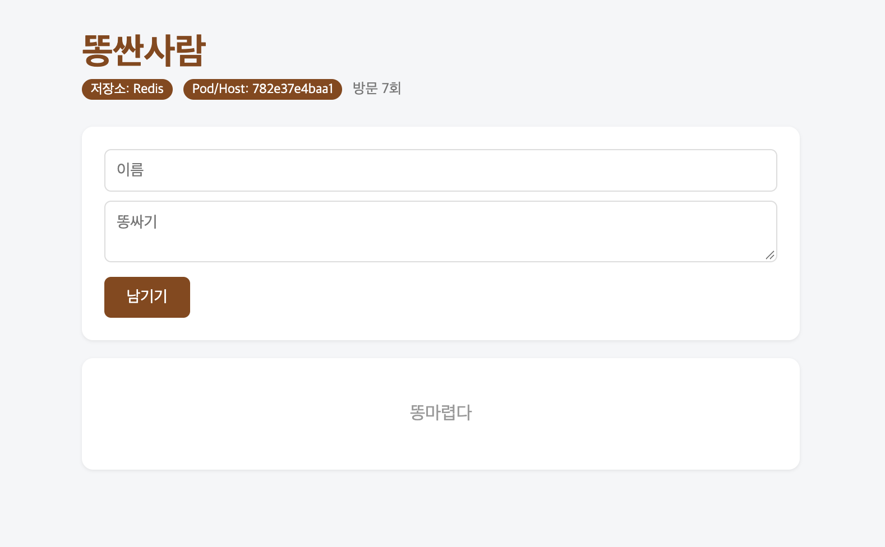
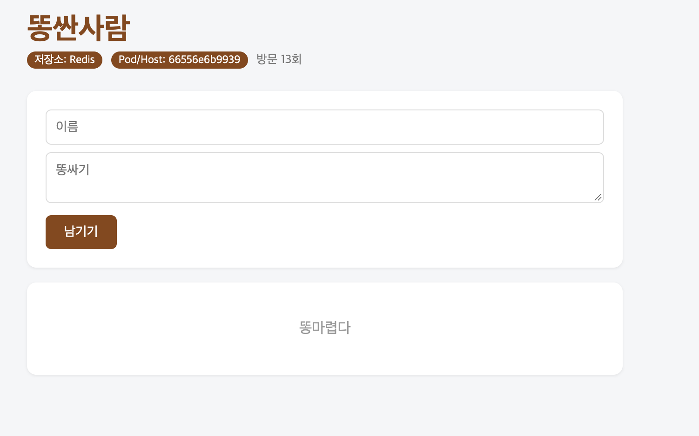

# 7주차 수업 내용 정리
- docker compose ps 결과
| NAME | IMAGE | COMMAND | SERVICE | CREATED | STATUS | PORTS |
| :--- | :--- | :--- | :--- | :--- | :--- | :--- |
| guestbook-nginx-1 | nginx:alpine | `"/docker-entrypoint.…"` | nginx | 15 minutes ago | Up 6 minutes | `0.0.0.0:8080->80/tcp`, `[::]:8080->80/tcp` |
| guestbook-redis-1 | redis:7-alpine | `"docker-entrypoint.s…"` | redis | 15 minutes ago | Up 15 minutes (healthy) | `6379/tcp` |
| guestbook-web-1 | guestbook-web | `"python app.py"` | web | 15 minutes ago | Up 15 minutes (healthy) | `5000/tcp` |
| guestbook-web-3 | guestbook-web | `"python app.py"` | web | 14 minutes ago | Up 14 minutes (healthy) | `5000/tcp` |

- scale 후 웹컨테이너 호스트명 바뀐 결과

- down 후 up / down -v 후 up 차이 비교
  - 그냥 down은 컨테이너만 내리는 것. 데이터는 volumes에 저장하기 때문에 down만 했을 때 방명록 기록 자체는 남아있음.
  - down -v 는 volumes까지 함께 down 한다는 뜻. volumes에 저장해둔 데이터까지 한 번에 없애버림.
  - 그냥 down 후 up을 하면 기존 방명록 데이터가 남아있음. 그러나 down -v 후 up을 하게되면 volumes 데이터가 사라지기 때문에 방명록이 비어있음.

- .env를 Git에 올리지 않는 이유
.env에는 민감한 정보(패스워드 등)을 넣어두는데, 해커(헌터)들이 초보자들의 그런 실수를 호시탐탐 노리고 있음.
.env를 업로드 해버리면 전세계 누구나 볼 수 있게 개인정보를 업로드 해버리는 꼴임. 공공재가 되어버림. 그래서 안올림.

