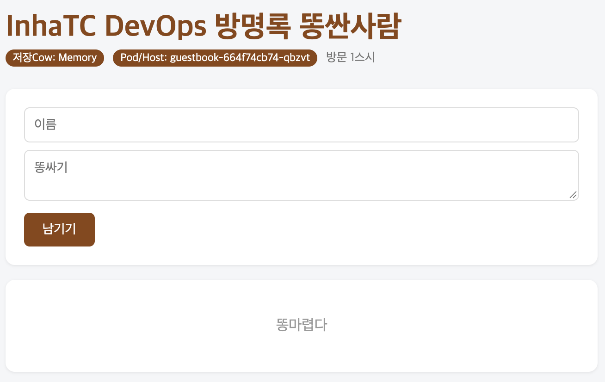

# 9주차

## kubectl get nodes 결과
| NAME | STATUS | ROLES | AGE | VERSION |
| :--- | :--- | :--- | :--- | :--- |
| minikube | Ready | control-plane | 127m | v1.37.0 |

## kubectl get pods -w 화면 확인 결과
| NAME | READY | STATUS | RESTARTS | AGE |
| :--- | :--- | :--- | :--- | :--- |
| guestbook-664f74cb74-qbzvt | 1/1 | Running | 0 | 2m8s |
- -w 옵션은 pods 상태 변화 생길 때마다 새로운 줄을 출력함 

## 쿠버네티스에서 뜬 브라우저 화면

## 선언형이란?
자동화 하는 것에 가까움. 내가 원하는 상태를 지정을 해두면, 해당 상태를 유지하도록 자동화 하는 것.
쿠버네티스는 Pod 개수를 체크하면서 Pod 개수 유지하는것. 자동화를 직접 하려면 어려울텐데, 
쿠버네티스로 하면 좀 편한가? 아직 잘 모르겠다.

## 오늘 잘 안됐던 것
- 이미지를 내 깃허브 패키지에 있는 걸 불러와야 하는데, 불러오는 과정에서 에러가 생겼다. Private로 해놔서 접근이 불가능해서 생기는 에러였다. Public으로 바꾸니 다시 잘 됐다.
- 확실히 터미널 환경 실습은 맥이나 리눅스가 편한 것 같다. 설치도 편하고, 그냥 편하다.
- 중간에 docker의 minikube 컨테이너를 멈췄다가 다시 시작했는데, kubectl 명령어가 안먹었다. docker의 minikube 컨테이너를 시작하는 것 만으론 안되고, minikube start를 통해 minikbue 자체를 살려줘서 해결됐다.
