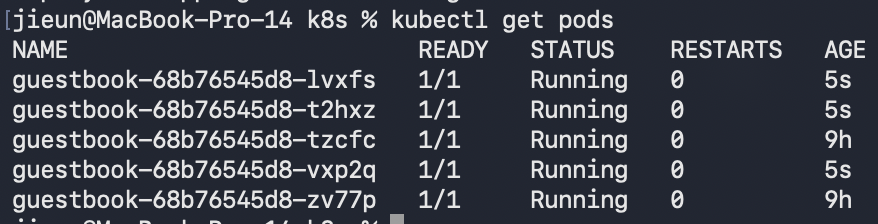
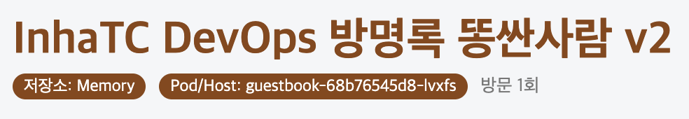
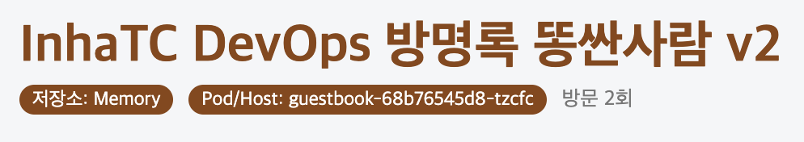
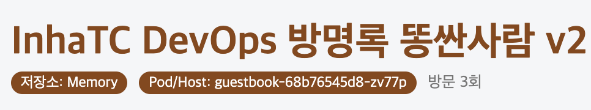
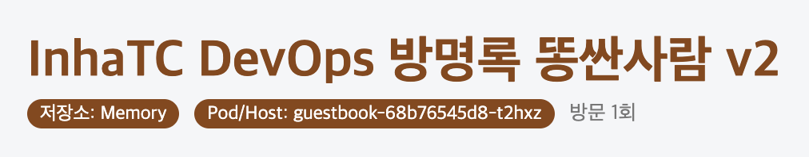
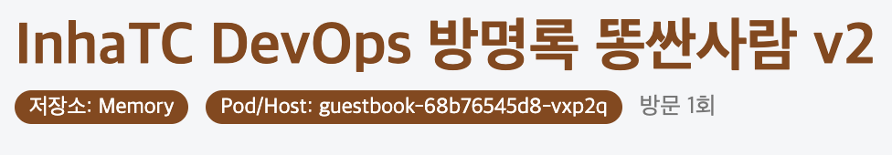
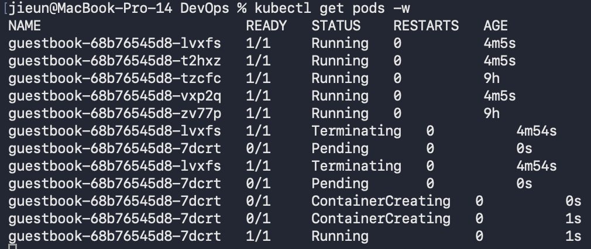
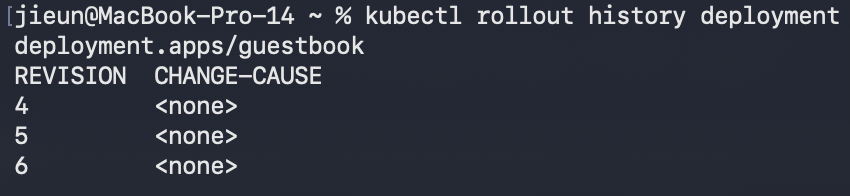

# 10주차 정리

- repliccas를 5로 늘리고 kubectl get pods 결과 캡쳐

- 서로 다른 Hostname 기록

- Pod 하나 삭제 후 자가치유 확인

- 롤링 업데이트 후 kubectl rollout history 결과 기록

- 롤백 수행 완료. guestbook:v3를 만들어서 적용된걸 확인 후 다시 v2로 롤백.
